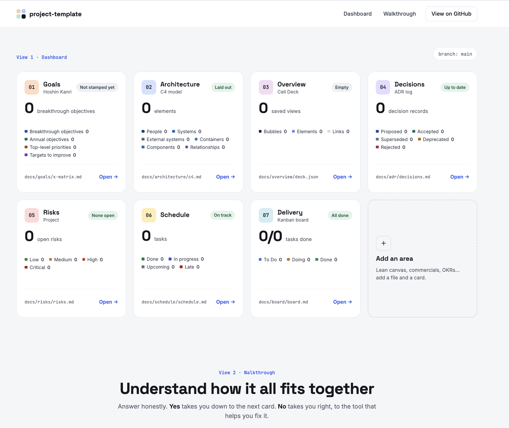

# Project Governance as Code

<!-- template:start -->
Store more than code - keep your project artifacts together: goals, architecture, decisions, risks,
interfaces, schedule, delivery, etc. -- all **as plain Markdown and JSON next to the code**, with a dashboard that
summarizes them.

**See it:** [aaronp.github.io/template](https://aaronp.github.io/template/) ·
[a filled-in example (Acme)](https://aaronp.github.io/template/demo/dashboard.html) ·
[the empty dashboard a new project starts with](https://aaronp.github.io/template/dashboard.html)

[](https://aaronp.github.io/template/dashboard.html)

## Rationale

Projects are self-contained units, with their respective data (goals, risks, architecture, tasks, etc) all in a text-based (typically markdown) form.

- **One place, so projects stay small.** Goals, risks, rationale and the schedule change together as a
  project evolves, so they live together, right beside the code. Keeping them current takes minutes,
  which makes it cheap to start small, scope tightly and notice when scope drifts.
- **A clear view for the whole team, human or AI.** Everyone on the project, people and AI agents alike,
  reads the same goals, plan, risks and decision log: plain text in the repo, searchable with `grep`,
  with the history of how each one got there.
- **Data, not software.** The project data is nearly all Markdown. The tools here are optional viewers:
  use them, use your own, or add and drop areas as the project needs. The data stays yours and outlives
  any tool.
- **Joined up history** All aspects of a project: risks, tasks, architecture, goals -- evolve together with clear history/lineage. Not just the code.  

## What's here

- `Template.dc.html`: the page describing this template, published at
  [aaronp.github.io/template](https://aaronp.github.io/template/).
- `@pritzlaff/project` (`package.json`, `bin/`, `lib/`, `dashboard/`): the CLI that adds the tools to a
  repo and builds its dashboard and walkthrough.
  [aaronp.github.io/template/dashboard.html](https://aaronp.github.io/template/dashboard.html) is what your
  project's site will look like on day one, and [the Acme demo](https://aaronp.github.io/template/demo/dashboard.html)
  once it's filled in.
- `manifest.json` and `cards/`: the tools the CLI can add, published with the site (not in the npm package).

## Using as a template

Create an empty repo on GitHub, then:

```sh
git clone https://github.com/aaronp/template.git && cd template
make clone        # asks for owner/repo and a project name; or REPO=… NAME=… DEST=…
make demo         # the Acme demo in ./temp/demo, served locally (Pages publishes it at /demo/)
```

`make clone` starts `../<repo>` as an install into an empty repo: a minimal `package.json`, this README
(without this section, with the project's name and Pages URL), `git init` with the origin set, then
`bunx @pritzlaff/project add all` and `bunx project pages`. The README links back to this template, using
this checkout's `origin` (or `TEMPLATE=<url>`).

A new project starts with every area's file empty (no example content). `make demo` fills them from
`examples/acme/docs`, each tool's own Acme example, in `./temp/demo-src` and builds the site into
`./temp/demo`.

### Adding to an existing repo

`bunx project list` shows every tool; `remove` and `update` take the same names. `add`, `remove` and `update` also keep a managed block of `make` targets in your `Makefile` (`--no-makefile` skips it).

```sh
bunx @pritzlaff/project add adr risks                      # or: add all; installs the tools, writes docs/
bunx project build --out _site/project --pages https://<owner>.github.io/<repo>/project/
bunx project pages                                         # or: a GitHub Pages workflow that publishes the dashboard
```

### Alongside an existing app and Pages workflow

If the repo already publishes an app (e.g. a React build in `dist/`), the app keeps the root and the project
site goes under `/project/`. No changes to the app or its router: Pages serves the real files under `/project/`
before any SPA fallback.

1. Add the tools, then commit what they write (`docs/`, `.project`, the `Makefile` block, `package.json`):

   ```sh
   bunx @pritzlaff/project add all     # or some: add adr risks schedule
   make dashboard                      # optional: the dashboard and its editors on http://localhost:8000
   ```

2. Optional, API docs: `bun add -d typedoc` and a `typedoc.json` (e.g. `{ "entryPoints": ["src/index.ts"] }`).
   With it, the build writes TypeDoc's output to `/project/api/`.

3. Add one step to the existing workflow, after the app build and before the upload. Either keep the upload path:

   ```yaml
         - run: bun run build                 # the existing app build → dist/
         - run: npx project build --out dist/project --pages https://<owner>.github.io/<repo>/project/
         - uses: actions/upload-pages-artifact@v3
           with:
             path: dist                       # unchanged
   ```

   `--pages` matters here: without it the cards link under `/<repo>/` rather than `/<repo>/project/`.
   Or let `--app` add the `/project/` part, and upload `_site` instead:

   ```yaml
         - run: npx project build --app dist --out _site
         - uses: actions/upload-pages-artifact@v3
           with:
             path: _site                      # was: dist
   ```

   `--app` copies `dist/` to `_site/`, so `--out` can't be `dist` itself.

4. Check the workflow:
   - Node 22 or newer (`actions/setup-node` with `node-version: 22`).
   - The install step installs devDependencies (`bun install`, `npm ci`; not `--production`): the tools are devDependencies.
   - Deploying by pushing to a `gh-pages` branch (e.g. `peaceiris/actions-gh-pages`) rather than `deploy-pages`:
     add `touch dist/.nojekyll`, or Jekyll converts the `docs/*.md` files the dashboard loads.
   - A custom domain: pass `--pages https://<your-domain>/project/` (the default comes from the git remote and
     only knows `github.io`).

5. Push. The site is then:

   | | URL |
   |---|---|
   | App (unchanged) | `https://<owner>.github.io/<repo>/` |
   | Links page (App, Dashboard, API docs) | `https://<owner>.github.io/<repo>/project/` |
   | Dashboard | `https://<owner>.github.io/<repo>/project/dashboard.html` |
   | API docs | `https://<owner>.github.io/<repo>/project/api/` |

With no workflow yet, `bunx project pages` writes one that does this when `package.json` has a `build` script.
[`examples/react-app`](examples/react-app) is a shadcn/React app set up this way, published at
[aaronp.github.io/template/react-app/](https://aaronp.github.io/template/react-app/) (`make react-app-build` builds it locally).

<!-- template:end -->
[](https://aaronp.github.io/template/dashboard.html) [](https://aaronp.github.io/template/dashboard.html) [](https://aaronp.github.io/template/dashboard.html) [](https://aaronp.github.io/template/dashboard.html) [](https://aaronp.github.io/template/dashboard.html) [](https://aaronp.github.io/template/dashboard.html)

Dashboard: https://aaronp.github.io/template/dashboard.html

## Running

```sh
make dashboard            # open the dashboard locally (= bunx project dashboard)
make dashboard-build      # generate it: _site/dashboard.html (= bunx project dashboard-build)
```

```sh
bunx project dashboard    # (alias dev) writes stale cards, serves and opens the dashboard on :8000 (NO_OPEN=1 skips), every area's editor on :8001+
bunx project snapshot     # just the cards and badges (--force: all of them, stale or not)
bunx project dashboard-build  # (alias build) the site Pages publishes, in _site/
bunx <tool> <file>        # edit one area's file in its tool's viewer on localhost (Save writes it back)
```

In the template repo, `make dashboard`, `make dashboard-build`, `make snapshot`, `make <area>`, `make <area>-snapshot` and `make test`
run this checkout's `bin/project.mjs` with `--manifest ./manifest.json`. `docs/project.json` records the
added tools (`project add` writes it).

| Area | `make` target | File | Tool | Format |
| --- | --- | --- | --- | --- |
| Goals | `goals` | `docs/goals/x-matrix.md` | [`@pritzlaff/hoshin-kanri`](https://github.com/aaronp/Hoshin-Kanri) | [spec.md](https://aaronp.github.io/Hoshin-Kanri/spec.md) |
| Architecture | `c4` | `docs/architecture/c4.md` | [`@pritzlaff/c4`](https://github.com/aaronp/c4) | [spec.md](https://aaronp.github.io/c4/spec.md) |
| Overview | `celldeck` | `docs/overview/deck.json` | [`@pritzlaff/celldeck`](https://github.com/aaronp/celldeck) | [deck.schema.json](https://aaronp.github.io/celldeck/deck.schema.json) |
| Decisions | `adr` | `docs/adr/decisions.md` | [`@pritzlaff/adr`](https://github.com/aaronp/adr) | [spec.md](https://aaronp.github.io/adr/spec.md) |
| Schedule | `gantt` | `docs/schedule/schedule.md` | [`@pritzlaff/gantt`](https://github.com/aaronp/gantt) | [spec.md](https://aaronp.github.io/gantt/spec.md) |
| Delivery | `agile` | `docs/board/board.md` | [`@pritzlaff/agile`](https://github.com/aaronp/agile) | [spec.md](https://aaronp.github.io/agile/spec.md) |
| Risks | `risks` | `docs/risks/risks.md` | [`@pritzlaff/risk-register`](https://github.com/aaronp/risk-register) | [spec.md](https://aaronp.github.io/risk-register/spec.md) |
| Interfaces | — | — | — | TODO: example figures on the dashboard |

Each area is its tool's **Adding it to your project** (in the tool's README) with the file under
`docs/<area>/`: the tools are dev dependencies in `package.json`, and the `Makefile` runs them. Every file is
plain text you can edit by hand or in its viewer. Each format is also in the installed package
(`node_modules/@pritzlaff/<tool>/spec.md`, or `deck.schema.json` for Cell Deck), matching the version in use,
so an agent working in this repo can read it before editing.

### Local vs deployed

Cards always link to the hosted tools on the published files (that is what `card.json` holds, and what
GitHub Pages serves). `project dev` also starts each area's own editor (`bunx <tool> <file>`'s
server) on its own port and serves `/local.js`, which maps each file to its editor; the dashboard then
sends card links there instead, keeping filters, so **Save writes to this checkout**. Pages has no
`local.js`, so nothing changes when deployed. It also watches `docs/`: saving a file (in its editor or your own)
rebuilds that card and the open dashboard reloads itself.

## Cards

Each area keeps its source next to the code and snapshots it into a `card.json` (plus a `badge.svg`)
in the same folder, e.g. `docs/adr/decisions.md` → `docs/adr/card.json` via `adr card` from
[`@pritzlaff/adr`](https://github.com/aaronp/adr). `card.json` is a tool-neutral format (version 1:
title, status pill, big number, a legend with counts and links), so the dashboard styles every
area the same way. `project snapshot` only rewrites a card when its source is newer, and the dashboard reads every
area's `card.json` through `docs/project.json`.

Overview is the exception: Cell Deck has no card export, so its manifest entry has
`"card": { "script": "cards/celldeck.mjs" }`; `project add` copies that script to `docs/cards/overview.mjs`,
which writes `docs/overview/card.json` from the deck (saved views as the headline; bubbles, elements and
links in the legend). An entry with `"card": false` gets a basic card (last changed date, link to the file).

Goals works the same way with `hoshin-kanri card`: its headline is the first section's count, with one
legend entry per section.

Card links open the hosted viewer with `?src=` pointing at the published markdown on this repo's
Pages site (worked out from the `origin` remote, or `--pages https://…/`), so they work
once the repo is pushed and published. To change a card's titles, labels or colours, use
**File → Design card…** in the viewer (`bunx adr docs/adr/decisions.md`) and save `decisions.card.json` beside the markdown.

## Adding an area

Add an entry to `manifest.json` (package, bin, file, viewer, dashboard text and an optional `starter`).
By default the tool writes the card itself (`<bin> card <file>` and `<bin> badge <file>`, in the same
format); otherwise set `card` to `{ "script": "cards/<tool>.mjs" }` or `false`. Then `project add <id>`.

## Hosting

Pushes to `main`/`master` publish the dashboard and `docs/` to GitHub Pages (`.github/workflows/pages.yml`,
written by `bunx project pages`, runs `project build`; Settings → Pages → Source: **GitHub Actions**).
